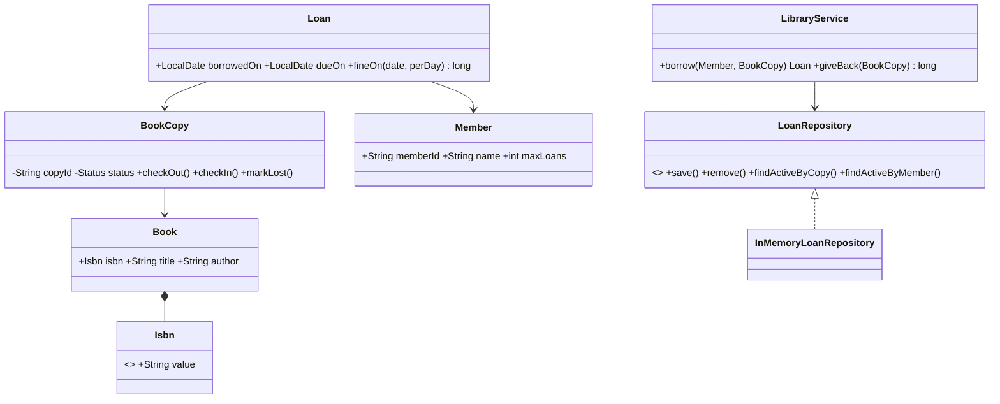
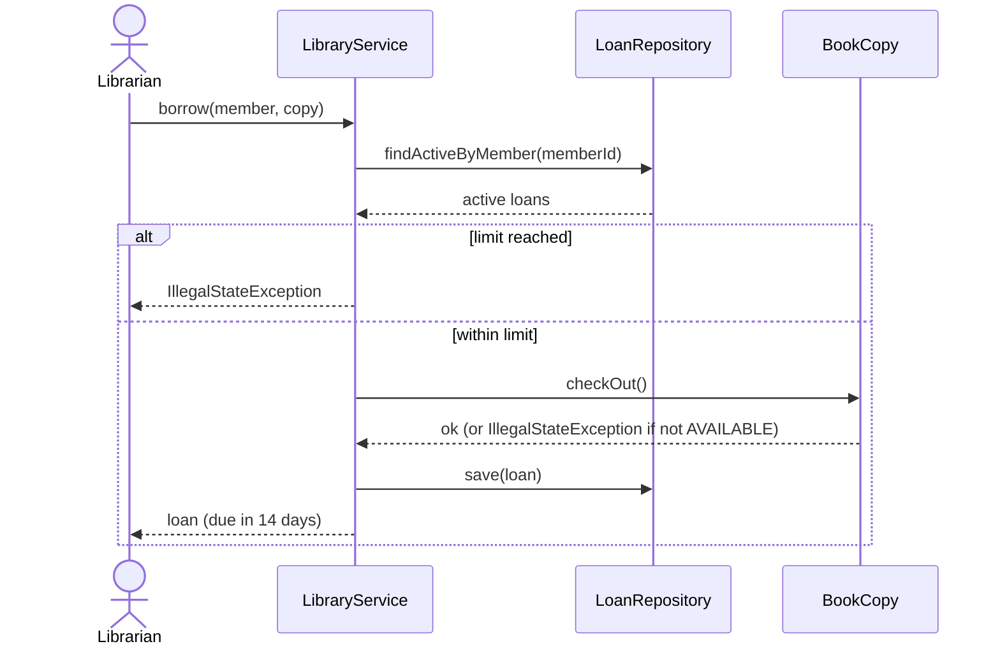
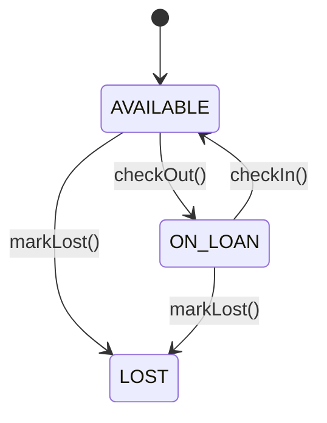
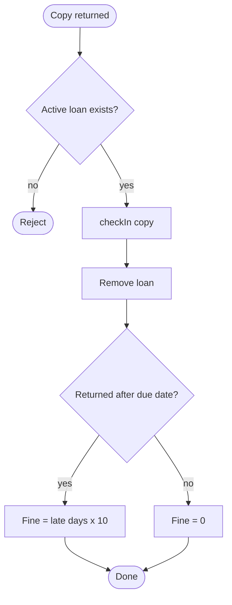

# Library system diagrams (Mermaid)

GitHub renders these diagrams automatically.

## Class diagram

## Sequence diagram: UC-1 Borrow book

## State diagram: BookCopy

## Activity diagram: UC-2 Return book

