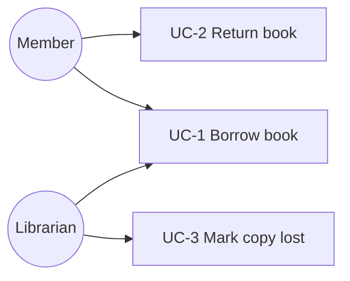

# 05 · Object-Oriented Analysis & Design (OOAD)

**Worked case study:** a library lending system, from requirements to tested code.
**Code:** [`ooad/library/`](../../src/main/java/dev/junaidul/principles/ooad/library) · **Tests:** [`LibraryServiceTest`](../../src/test/java/dev/junaidul/principles/ooad/LibraryServiceTest.java) · **Diagrams:** [`docs/diagrams/library.md`](../../docs/diagrams/library.md)

OOAD has two phases:
- **Analysis**: *what* the problem is, in domain language (requirements, use cases, domain model).
- **Design**: *how* software objects will solve it (responsibilities, collaborations, class and sequence diagrams).

## Step 1 · Requirements
Functional:
- R1. A member can borrow an **available** copy of a book.
- R2. A member may hold at most `maxLoans` copies at once.
- R3. A loan lasts 14 days; late returns cost 10 per day.
- R4. A copy can be marked lost.

Non-functional: testable without a database; "today" must be controllable in tests.

## Step 2 · Use cases

**UC-1 Borrow book (main success scenario):** member presents card → librarian scans copy → system checks loan limit (R2) and availability (R1) → system records loan with due date → copy becomes ON_LOAN.
*Extensions:* 3a limit reached → reject. 3b copy not available → reject.

## Step 3 · Domain model (nouns → concepts, verbs → associations)
Nouns from the requirements: member, book, copy, loan, fine, due date. Note the classic insight: **Book** (a title) ≠ **BookCopy** (a physical item).

## Step 4 · CRC cards
| Class | Responsibilities | Collaborators |
|---|---|---|
| BookCopy | know status; enforce AVAILABLE→ON_LOAN→AVAILABLE | Book |
| Loan | know dates; compute fine | Member, BookCopy |
| LibraryService | run Borrow/Return use cases; enforce limits | LoanRepository, Clock |
| LoanRepository | store and find active loans | Loan |

## Step 5 · Design diagrams
Class, sequence, state and activity diagrams are in [`docs/diagrams/library.md`](../../docs/diagrams/library.md).

## Step 6 · Code and tests
Each requirement maps to a guard in `LibraryService` and a test in `LibraryServiceTest`. That traceability (requirement → code → test) is the point of OOAD.

## UML cheat sheet
| Notation | Meaning |
|---|---|
| `A <|-- B` | B inherits from A (generalisation) |
| `A <|.. B` | B implements interface A (realisation) |
| `A --> B` | association / dependency |
| `A o-- B` | aggregation (B can exist alone) |
| `A *-- B` | composition (B's lifecycle is owned by A) |
| `+ - # ~` | public, private, protected, package visibility |

## Common mistakes
- Jumping straight to classes from a feature title, skipping use cases.
- Modelling database tables instead of domain behaviour.
- Diagrams that never get updated. Keep them small, close to the code, and in text (Mermaid) so they are reviewed in PRs.

## Practice
Model a **parking lot** using the same six steps: spots of different sizes, tickets, payment, entry/exit gates. Compare your model with the library one.

## Interview questions
1. What is the difference between analysis and design?
2. Walk through how you'd design an elevator / parking lot / vending machine.
3. Aggregation vs composition, with examples.
4. How do sequence diagrams help find missing responsibilities?
