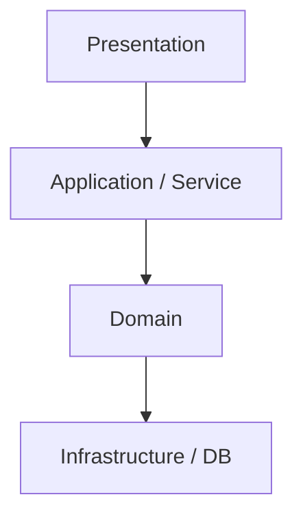
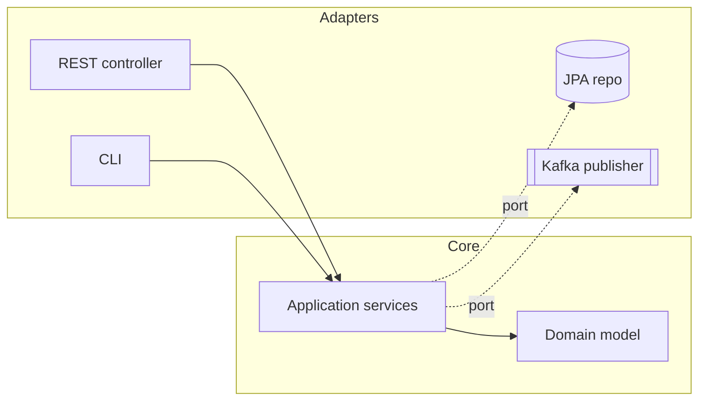

# 07 · Architecture patterns

**Code:** [`Hexagonal.java`](../../src/main/java/dev/junaidul/principles/architecture/Hexagonal.java) (ports and adapters + CQRS + domain events) · **Tests:** [`HexagonalTest`](../../src/test/java/dev/junaidul/principles/architecture/HexagonalTest.java)

Architecture is the set of decisions that are expensive to change. Its main tool is **controlling the direction of dependencies**.

## Layered (n-tier)

Simple and familiar. Risk: domain depends on the database layer, so business rules get tangled with persistence.

## Hexagonal / Ports and Adapters, Clean Architecture, Onion

**Dependency rule:** source code dependencies point *inward*. The core defines ports (interfaces); adapters implement them. Clean Architecture (entities → use cases → interface adapters → frameworks) and Onion are variations of the same idea.

## MVC / MVVM
- **MVC:** Controller handles input, Model holds state/logic, View renders. (Spring MVC, Rails.)
- **MVVM:** ViewModel exposes observable state that the View binds to. (Android Jetpack, Angular, SwiftUI.)

## Event-driven architecture
Services publish facts (`TaskCompleted`) and others subscribe. Loose coupling and easy fan-out, at the cost of eventual consistency and harder debugging. Use an outbox table so DB writes and events stay consistent.

## CQRS
Separate the write model (commands, invariants) from read models (queries, denormalised views). Worth it for complex domains or very different read/write loads. Often paired with event sourcing, though not required.

## Monolith vs modular monolith vs microservices
| | Monolith | Modular monolith | Microservices |
|---|---|---|---|
| Deploy | one unit | one unit | many units |
| Boundaries | weak | enforced modules (e.g. Spring Modulith, ArchUnit) | network |
| Ops cost | low | low | high (observability, distributed tx, versioning) |
| Best for | small teams, new products | most teams, most of the time | many teams needing independent deploy/scale |

> Start with a well-modularised monolith. Extract a service only when a boundary is stable and has a real scaling or team-autonomy reason.

## Interview questions
1. What problem does hexagonal architecture solve compared to layered?
2. When is CQRS overkill?
3. How do you keep data consistent across microservices (saga, outbox)?
4. What is a distributed monolith?
