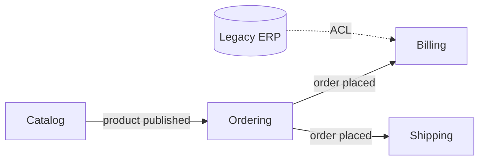

# 08 · Domain-Driven Design basics

**Code:** [`Ordering.java`](../../src/main/java/dev/junaidul/principles/ddd/Ordering.java) · **Tests:** [`OrderingTest`](../../src/test/java/dev/junaidul/principles/ddd/OrderingTest.java)

DDD (Eric Evans) puts the business domain at the centre of design and keeps the model in sync with how domain experts talk.

## Strategic design
- **Ubiquitous language:** one shared vocabulary in conversations, code, and tests. If the business says "place an order", the method is `place()`, not `setStatus(2)`.
- **Bounded context:** a boundary inside which a model and its language are consistent. "Product" in Catalog (descriptions, images) differs from "Product" in Shipping (weight, dimensions).
- **Context map:** how contexts relate: shared kernel, customer/supplier, anti-corruption layer (an adapter that translates a foreign model).

## Tactical building blocks
| Block | Definition | In the code |
|---|---|---|
| Entity | identity that persists over time | `Order` (has `OrderId`) |
| Value object | defined by its values, immutable | `Money`, `OrderId` |
| Aggregate | cluster changed as one unit; root guards invariants | `Order` + `OrderLine` |
| Repository | collection-like access to aggregates | `OrderRepository` |
| Domain service | logic that fits no single entity | e.g. pricing across aggregates |
| Domain event | a fact that happened | see `TaskCompleted` in topic 07 |

## Aggregate rules of thumb
1. Reference other aggregates **by id**, not by object.
2. One transaction modifies **one** aggregate; use events for the rest.
3. Keep aggregates small.

## Common mistakes
- Using DDD for CRUD apps with no real business rules.
- Anemic entities with public setters, which bypass invariants.
- One giant "model" shared by every team (no bounded contexts).

## Interview questions
1. Entity vs value object?
2. Why should an aggregate be the transaction boundary?
3. What is an anti-corruption layer?
