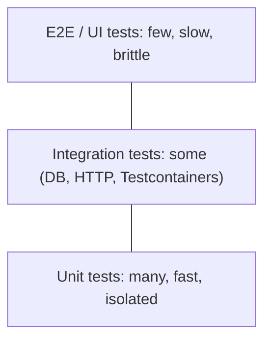

# 11 · Testing practices

**Code:** [`Testing.java`](../../src/main/java/dev/junaidul/principles/testing/Testing.java) · **Tests:** [`TestingTest`](../../src/test/java/dev/junaidul/principles/testing/TestingTest.java) (TDD, stub, hand-written mock, BDD naming, property-based style)

## Test pyramid

Many fast unit tests, fewer integration tests, very few end-to-end tests. (The "testing trophy" variant puts more weight on integration tests; both agree that slow UI tests should be rare.)

## Good unit tests are FIRST
**F**ast · **I**ndependent · **R**epeatable · **S**elf-validating · **T**imely. Structure each as **Arrange–Act–Assert** (or Given–When–Then).

## TDD: red → green → refactor
1. Write a failing test for the next tiny behaviour.
2. Write the minimum code to pass.
3. Refactor with the test as a safety net.
`fizzBuzz` in this repo was built with one test case per step.

## Test doubles
| Double | Purpose | Here |
|---|---|---|
| Dummy | fills a parameter, never used | - |
| Stub | returns canned answers | fixed `Clock` |
| Fake | working light implementation | `InMemoryLoanRepository` |
| Spy / Mock | records calls so you can verify interactions | `RecordingSender` |
Libraries: Mockito, MockK. Mock **roles you own**, not third-party types; prefer fakes for repositories.

## BDD
Describe behaviour in business language: `Given a greeter, when it is 09:00, then it says good morning` (JUnit `@Nested` + `@DisplayName`, or Cucumber/Gherkin for stakeholder-readable specs).

## Property-based testing
Instead of examples, state an invariant ("reverse twice = original") and check it against many generated inputs. Libraries: jqwik (Java), Hypothesis (Python), fast-check (JS). Always seed randomness so failures reproduce.

## Also know
- Code coverage is a guide, not a goal; 100% coverage can still miss bugs. Mutation testing (PIT) measures test quality.
- Contract tests (Pact) for service boundaries; Testcontainers for real DBs in integration tests.
- Flaky tests destroy trust: fix or quarantine them immediately.

## Interview questions
1. Mock vs stub vs fake?
2. What makes code hard to test, and how do you fix it? (hidden dependencies: time, randomness, statics, `new` inside methods)
3. Does TDD slow teams down?
