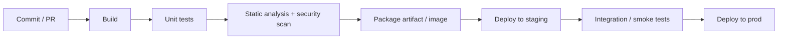

# 17 · CI/CD and DevOps basics

This repo's own pipeline: [`.github/workflows/ci.yml`](../../.github/workflows/ci.yml) builds and tests on every push and pull request.

## Definitions
- **Continuous Integration:** merge small changes to main often; every change is built and tested automatically.
- **Continuous Delivery:** every green build is releasable with a button.
- **Continuous Deployment:** every green build goes to production automatically.

## A typical pipeline

## Practices
- Build once, promote the **same artifact** through environments.
- Pipelines as code, versioned with the app.
- Fast feedback: keep CI under ~10 minutes; cache dependencies.
- Trunk-based development + feature flags to decouple deploy from release.
- Safe releases: blue-green, canary, rolling; automatic rollback on bad health.
- Infrastructure as Code (Terraform, Pulumi), immutable infrastructure, containers (Docker) and orchestration (Kubernetes) where justified.
- Shift-left security: dependency scanning, SAST, secret scanning, signed artifacts.

## DORA metrics
Deployment frequency · Lead time for changes · Change failure rate · Time to restore service.

## Interview questions
1. Continuous delivery vs deployment?
2. How do feature flags help, and what debt do they create?
3. How do you roll back a bad database migration? (expand-contract migrations)
