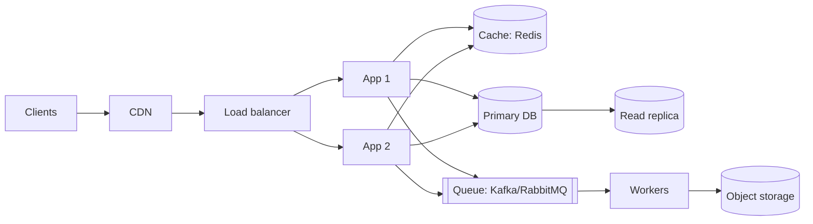

# 20 · System design fundamentals

## A framework for any design question
1. **Clarify requirements:** functional (what), non-functional (scale, latency, availability, consistency).
2. **Estimate:** users, QPS, storage, bandwidth (back-of-the-envelope).
3. **API and data model.**
4. **High-level design:** boxes and arrows.
5. **Deep dive** into bottlenecks; discuss trade-offs and failure modes.

## Building blocks
**Load balancing:** L4 (TCP) vs L7 (HTTP) balancers; round-robin, least-connections, consistent hashing. Health checks, stateless app servers.

**Caching:** client → CDN → application cache → DB cache.
| Strategy | How |
|---|---|
| Cache-aside | app reads cache, on miss loads DB and fills cache (most common) |
| Write-through | write cache and DB together |
| Write-behind | write cache, flush DB async (risk of loss) |
Eviction: LRU/LFU + TTL. Watch for stampedes (use locks or early refresh) and stale data.

**Databases:**
- SQL (PostgreSQL/MySQL): ACID, joins, strong schema. Default choice.
- NoSQL: key-value (Redis, DynamoDB), document (MongoDB), wide-column (Cassandra), graph (Neo4j). Chosen for access pattern and scale.
- Scale reads with replicas; scale writes with partitioning/sharding (choose shard keys to avoid hot spots). Index the queries you run.

**CAP theorem:** during a network **P**artition, a distributed store chooses **C**onsistency or **A**vailability. PACELC adds: *else*, latency vs consistency. Know eventual vs strong consistency.

**Queues and streams:** decouple producers and consumers, absorb spikes, retries with dead-letter queues. Delivery is usually *at-least-once*, so consumers must be **idempotent**.

**Other:** rate limiting (token bucket), unique id generation (UUIDv7, Snowflake), blob storage + CDN for media, search indexes (Elasticsearch/OpenSearch), consistent hashing, replication and leader election, back-pressure.

## Reliability patterns
Timeouts · retries with exponential backoff + jitter · circuit breaker · bulkhead · graceful degradation · health checks and redundancy across zones.

## Practice problems
URL shortener · rate limiter · chat app · news feed · notification service · file storage · ride sharing.

## Interview questions
1. Design a URL shortener for 100M URLs/month.
2. How do you keep cache and DB consistent?
3. SQL or NoSQL for X, and why?
